<div align="center">

# 🐾 Myaow iOS — Privacidad Cercana, Expresión Viva y Colaboración Cifrada

**Plataforma nativa de mensajería E2EE (HPKE RFC 9180 v2), Radio Push-to-Talk híbrida (WebRTC + P2P Cercano), videollamadas con filtros faciales en tiempo real, 23 ambientes cinematográficos procedurales y espacios de proyectos colaborativos para iPhone.**

[](https://swift.org)
[](https://developer.apple.com/ios/)
[](https://developer.apple.com/xcode/swiftui/)
[](#️-arquitectura-criptográfica-e-interoperabilidad-ios--android)
[](#-radio-myaow-ptt-híbrido--pulso-acústico-sintetizado)
[](#️-arquitectura-del-sistema-zero-knowledge-gateway)

[**📱 Ver Cliente Nativo Android (`Myaow-Android`) →**](https://github.com/myalexverse/Myaow-Android) · [**🌐 Portafolio de Ingeniería →**](https://myalexverse.github.io)

</div>

---

## ✨ Visión del Producto: *"Tecnología que se siente cercana"*

**Myaow** reinventa la comunicación privada eliminando la dependencia de números telefónicos y combinando **criptografía autenticada de extremo a extremo (HPKE RFC 9180)** con una experiencia sensorial cálida, expresiva y orientada a lograr cosas en equipo:

- 🔐 **Identidad Criptográfica Soberana (Sin Teléfono):** Tu identidad es un par de llaves **Curve25519 (X25519)** generado en el dispositivo y resguardado en el **Keychain de iOS** (`ThisDeviceOnly`), con autenticación de conocimiento cero por reto/prueba de posesión (`myaow-x25519-hkdf-sha256-v2`).
- 🐱 **Expresión con Voz Propia:** **31 expresiones y actitudes felinas**, **14 maullidos sonoros** con diseño acústico y háptico coreografiado, **30 reacciones**, y un **estudio de stickers personalizados** con recorte automático de sujeto en dispositivo.
- 🎬 **Ambiente Vivo (23 Fondos Cinematográficos Procedurales):** Motor gráfico que sintetiza y reproduce 23 composiciones en bucle continuo H.264 (*Eclipse de Cobre, Mar de Titán, Lluvia Neón, Cristal Alienígena, Nebulosa Violeta, Lava Turquesa...*) con continuidad de fotograma durante transiciones `NavigationStack`.
- 📻 **Radio Myaow (Walkie-Talkie PTT Híbrido) y Pulso Myaow:** Consola dedicada de comunicación Push-to-Talk por Internet (**WebRTC**) y **Cercanía Offline P2P** sin red celular, equipada con **7 señales acústicas originales sintetizadas en tiempo real** (1320/1810 Hz) e integración con el **Botón de Acción del iPhone (`AppIntents`)**.
- 🎭 **Videollamadas E2EE con 5 Filtros Faciales Locales y Portal a Dúo:** Procesamiento local de rostro (cabeza, ojos, boca y gesticulación sin enviar biometría a la nube) y **Portal a Dúo** interactivo para enviar estrellas, peces y gatitos en tiempo real durante la llamada.
- 📋 **Grupos Colaborativos y Espacios de Proyectos (`ProjectWorkspace`):** De conversar a ejecutar juntos: objetivo compartido, cálculo automático de salud del proyecto, calendario plegable con zona horaria, propuestas compartidas con votación retirable de miembros y conversión directa de mensajes o propuestas a tareas con evidencias multimedia.

---

## 📸 Galería Visual del Ecosistema iOS

### 1. Conversaciones Cifradas, Ambiente Vivo y Maullidos Sonoros
| Chat Grupal con Fondo *Cristal* y Maullido | Maullidos Expresivos y Decoración Compartida | Catálogo *Decorar Chat* (Local o Compartido) | Selector de 30 Reacciones Instantáneas |
|:---:|:---:|:---:|:---:|
| 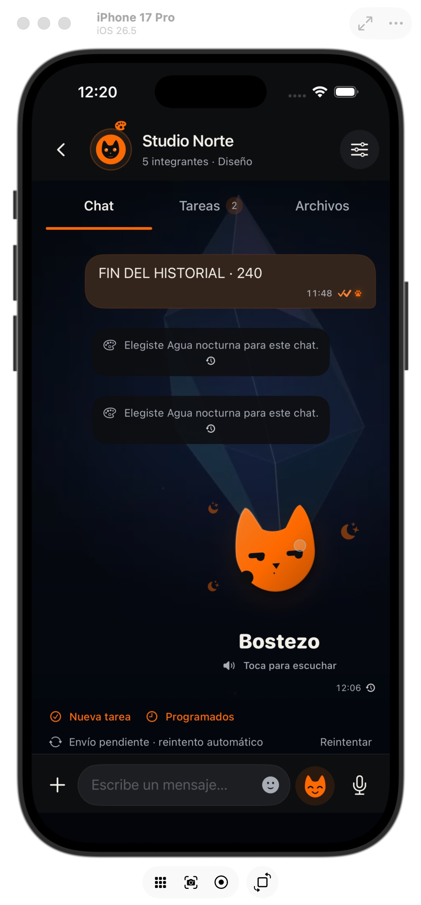 | 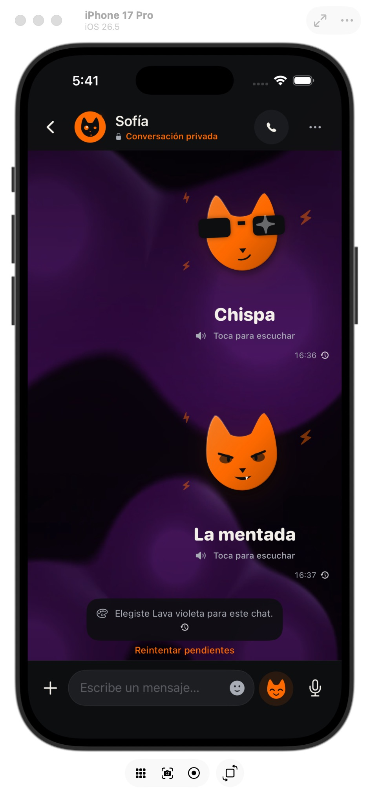 | 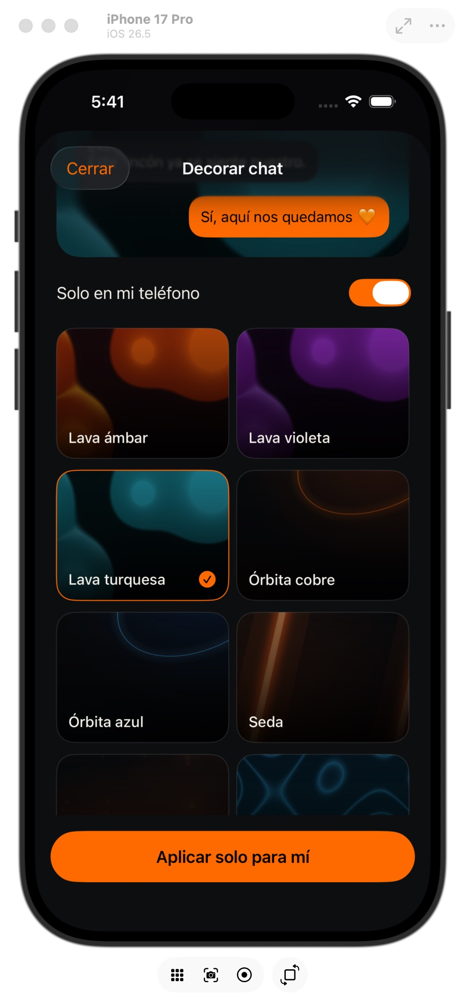 | 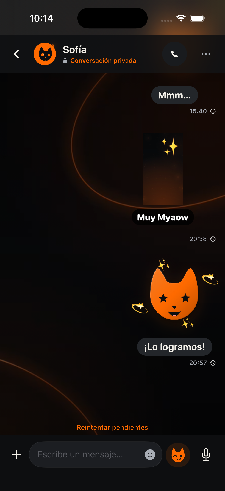 |

### 2. Expresión Felina (31 Estados), Grupos, Proyectos, Filtros de Video y Radio PTT
| 31 Formas de Ser Tú (Emociones) | Selector de Actitud y Estado Activo | Tablero de Avance Grupal y Misiones | Filtros de Video Locales (*Gatoverso & Portal*) | Consola de Audio & Radio PTT WebRTC |
|:---:|:---:|:---:|:---:|:---:|
| 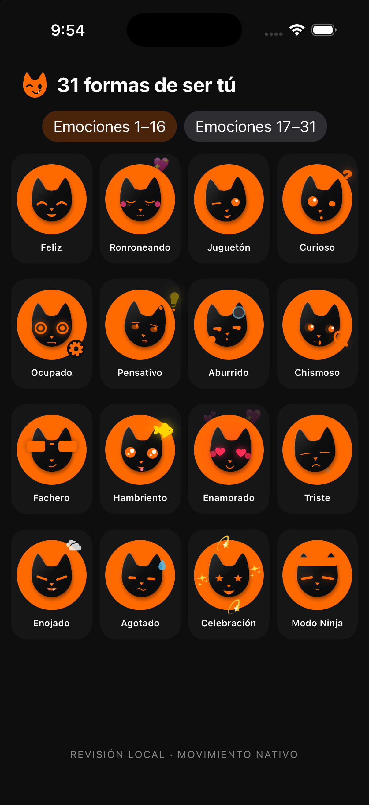 | 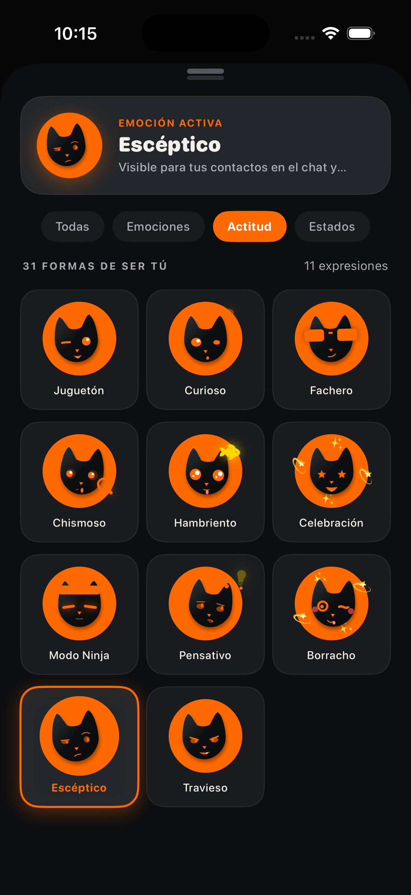 | 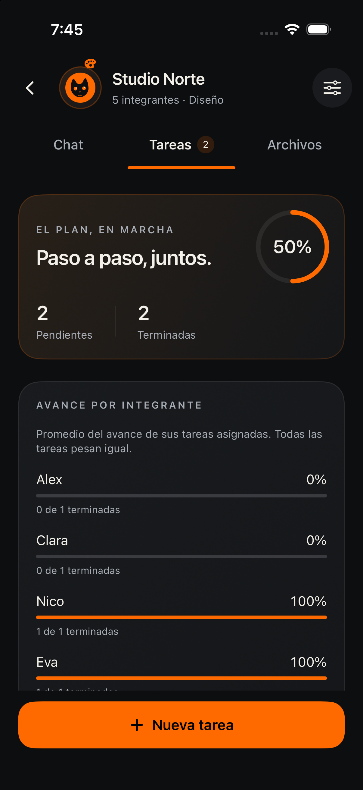 | 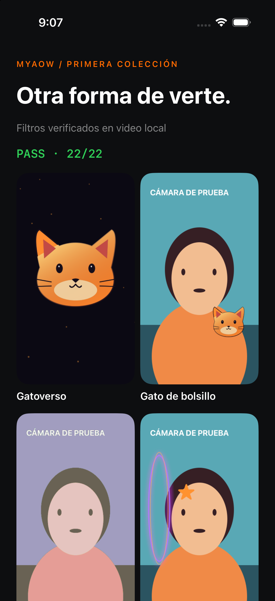 | 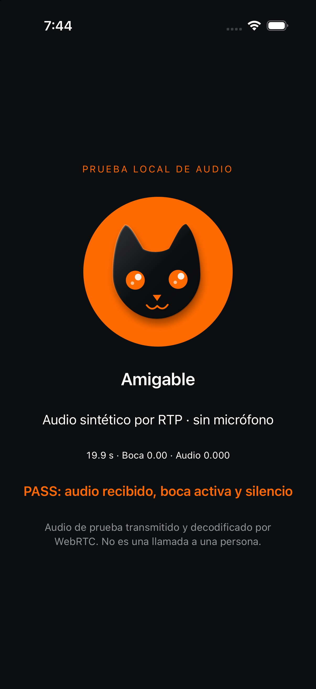 |

### 3. Colección Cinematográfica *Cine & Futuros* y Dirección de Identidad
| Colección Procedural *Cine & Futuros* (10 Composiciones H.264) | Dirección de Identidad Visual — *Un gato. Una voz propia.* |
|:---:|:---:|
| 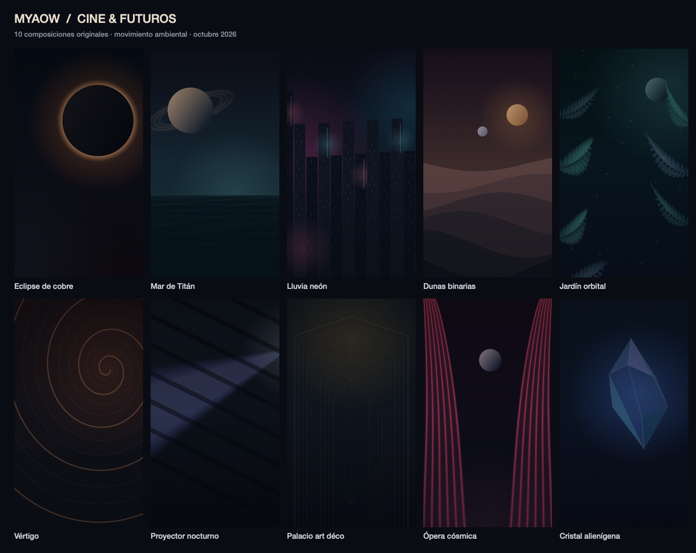 | 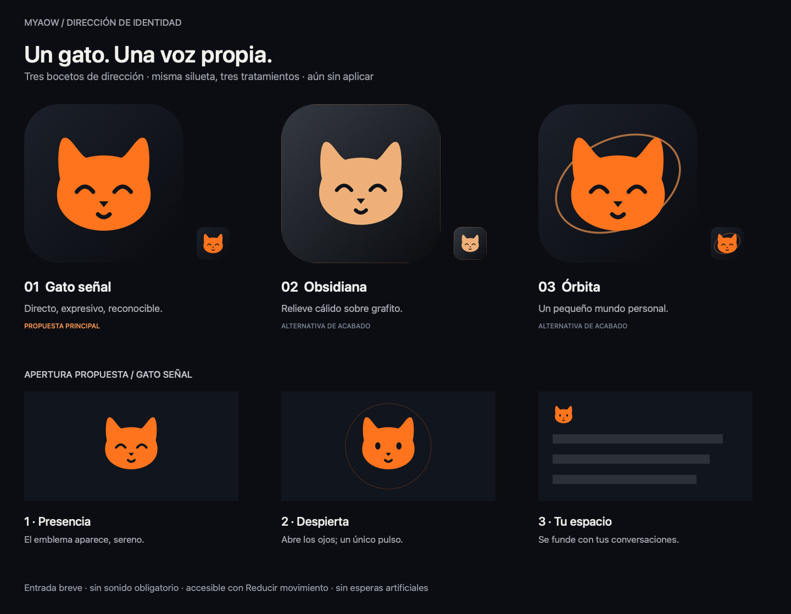 |

---

## 🏗️ Arquitectura del Sistema (Zero-Knowledge Gateway)

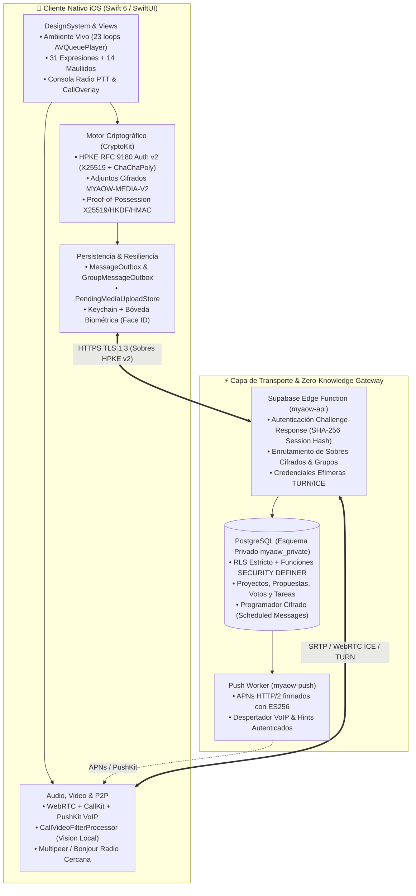

---

## 🛡️ Arquitectura Criptográfica e Interoperabilidad (`iOS ⇄ Android`)

El cliente iOS comparte un **contrato criptográfico binario exacto** con [**Myaow Android**](https://github.com/myalexverse/Myaow-Android), validado automáticamente mediante fixtures cruzados (`Scripts/validate-android.sh`) que cifran en Swift (`CryptoKit`) y descifran en Kotlin (`Bouncy Castle 1.86`) y viceversa:

### 1. Sobres de Mensajes (`HPKE RFC 9180 — Modo Auth v2`)
- **Suite:** `DHKEM(X25519, HKDF-SHA256)` (`0x0020`), `KDF: HKDF-SHA256` (`0x0001`), `AEAD: ChaCha20-Poly1305` (`0x0003`).
- **Contexto Autenticado (`info` = `AAD`):** Array JSON compacto determinista `["MYAOW-HPKE-AUTH-V2", messageId, senderId, recipientId]` (más `"group", groupId` en conversaciones grupales), vinculando criptográficamente metadatos de ruta, grupo e identidad del remitente.
- **Mutaciones Firmadas (`SecureMessageMutation`):** Ediciones, eliminaciones para todos y reacciones viajan firmadas y autenticadas para impedir suplantación o resurrección de mensajes borrados fuera de orden.

### 2. Archivos Multimedia Cifrados (`MYAOW-MEDIA-V2`)
- Cada foto, video, documento o nota de voz se cifra en el dispositivo antes de tocar la red usando una llave efímera aleatoria de **256 bits (32 bytes)** y nonce de **96 bits (12 bytes)** con **ChaCha20-Poly1305** (`AAD = "MYAOW-MEDIA-V2"`).
- El servidor de almacenamiento solo recibe blobs binarios opacos (`nonce || ciphertext || tag`); la llave de descifrado viaja exclusivamente dentro del sobre HPKE v2.

### 3. Autenticación sin Contraseña (`myaow-x25519-hkdf-sha256-v2`)
- El servidor emite un desafío único de un solo uso (`nonce` + `serverPublicKeyHex`).
- El dispositivo realiza un acuerdo **X25519** rechazando claves de bajo orden, deriva una llave con **HKDF-SHA256** sobre el contexto separado por bytes `NUL` (`MYAOW-AUTH-V2\0id\0nonce\0serverPub\0clientPub`) y responde con un `HMAC-SHA256`. La llave privada jamás abandona el teléfono.

---

## 🚀 Módulos e Ingeniería Destacada

### 📻 Radio Myaow (PTT Híbrido) & Pulso Acústico Sintetizado
- **Consola Dedicada (`RadioSessionView`):** Flujo propio separado de llamadas convencionales, con máquina de estados explícita (`SIN ENLACE`, `ENLAZANDO`, `CANAL LIBRE`, `SOLICITANDO TURNO`, `TRANSMITIENDO`, `RECIBIENDO`, `ENLACE CERRADO`).
- **Doble Transporte:**
  - **Radio por Internet:** Transporte **WebRTC** integrado con **CallKit**, exclusión mutua de turnos (límite de 60 s por intervención) y medidor de recepción alimentado por amplitud **RTP real**.
  - **Radio Cercana (Offline P2P):** Comunicación directa sin Internet entre dispositivos próximos con consentimiento bilateral, verificación de identidad y transmisión **PCM16 mono cifrada**.
- **Pulso Myaow (`RadioSoundSynthesizer`):** Motor de síntesis matemática en memoria que genera **7 señales acústicas WAV originales** sin usar muestras pregrabadas:
  - Apertura doble (`1320 / 1810 Hz`), cierre descendente (`1810 / 1060 Hz`), enlace ascendente (`880 / 1320 / 1810 Hz`), tono de ocupado grave y portadora breve filtrada, con control de intensidad persistente (`0–100%`) y modo de preescucha ambiental seguro.

### 📋 Grupos Colaborativos, Proyectos y Misiones (`ProjectWorkspace`)
- **Tres Dimensiones por Grupo:** Pestañas sincronizadas de **Chat Cifrado**, **Tareas/Proyectos** y **Archivos/Evidencias**.
- **Espacio de Proyecto Compartido:**
  - Definición de **objetivo del equipo**, fecha de inicio/cierre con calendario plegable consciente de zona horaria, fecha de próxima revisión y **cálculo automático de salud** junto al estado manual (*Activo / En pausa / Cerrado*).
  - **Propuestas y Votación Democrática:** Tarjetas de propuestas separadas en *«Por decidir»* y *«En el plan»*, con votos retirables validados en servidor y conversión directa de propuesta aprobada a tarea asignada.
  - **Misiones con Evidencia Multimedia:** Tareas normales, importantes o urgentes, condición de **tarea clave**, ritmo **Diario / Semanal**, progreso `0–100%` y bitácora de evidencias (fotos, videos, documentos) vinculadas al historial del chat.

### 🎭 Llamadas VoIP E2EE, 5 Filtros Faciales en Vivo y Portal a Dúo
- **Llamadas 1 a 1 de Voz y Video:** Señalización cifrada anti-replay, reconexión ICE/TURN, soporte de segundo plano y bloqueo vía **CallKit / PushKit**, y **Picture-in-Picture (PiP)** nativo.
- **5 Filtros de Video en Tiempo Real (`CallVideoFilterProcessor`):** *Natural*, *Gatoverso*, *Gato de bolsillo*, *Tinta viva* y *Portal a dúo*, impulsados por seguimiento facial local en el dispositivo (cabeza, ojos, boca y gesticulación felina sin dientes) con ajuste automático por presupuesto térmico y de batería.
- **Portal a Dúo:** Experiencia interactiva sincrónica durante la videollamada que permite enviar regalos animados (*estrella, pez, gatito*) por canal de datos autenticado con control de caducidad y cooldown.

### 🎨 Ambiente Vivo (23 Fondos en Video) & Personalización Profunda
- **Generación Procedural (`Scripts/CinematicWallpaperArtwork.swift`):** 23 fondos de video H.264 (`540×960`, `24 fps`, `10 s`, `< 2 MB` por pieza, sin pista de audio) divididos en colecciones *Ambiente*, *Ciencia Ficción* (*Nebulosa Violeta, Aurora Ionizada, Portal Ámbar, Retícula Neón*) y *Cine & Futuros* (*Eclipse de Cobre, Mar de Titán, Lluvia Neón, Dunas Binarias, Jardín Orbital, Vértigo, Proyector Nocturno, Palacio Art Déco, Ópera Cósmica, Cristal Alienígena*).
- **Transiciones sin Reinicio:** Arquitectura de doble reproductor retenido (`AVQueuePlayer`) donde la decoración de cada conversación viaja junto con la vista durante el push/pop de `NavigationStack`, pausando el fondo raíz en su fotograma exacto y liberando recursos automáticamente en segundo plano, llamadas o modo *Reducir movimiento*.
- **10 Iconos Alternativos de Aplicación:** *Classic, Cyber Neon, Liquid Glass, OLED Noir, Holo Space, Gold, Matcha, Magma, Pixel 8-Bit* y *Furry*.

### 🔒 Privacidad Integral: Bóveda Biométrica, Moderación IA Local y Programación Cifrada
- **Bóveda Cifrada (`Vault`):** Espacio protegido por **Face ID / Touch ID** para resguardar llaves, enlaces y notas críticas con cierre inmediato al cambiar de app.
- **Moderación de Contenido con IA en Dispositivo (`Core/AI`):** Detección local en español para texto e imágenes sensibles con desenfoque preventivo y revelado voluntario, sin telemetría ni envío a APIs externas.
- **Mensajes Programados (`ScheduledMessagesService`) y Temporales (`DisappearingMessagesService`):** Los mensajes programados se cifran en el dispositivo del autor antes de enviarse a la cola del servidor; el backend los entrega en la fecha UTC programada sin conocer jamás el texto plano.

---

## 📂 Estructura del Repositorio

```text
Myaow-iOS/
├── Myaow/
│   ├── Core/
│   │   ├── AI/                  # Moderación local de texto e imagen en dispositivo
│   │   ├── Audio/               # Grabación/reproducción de notas de voz y Walkie-Talkie
│   │   ├── Backend/             # Cliente Supabase Edge, directorio, grupos, proyectos, tareas y outbox
│   │   ├── Calling/             # Motor WebRTC, CallKit, filtros de video en vivo y Portal a Dúo
│   │   ├── Crypto/              # HPKE RFC 9180 v2, ChaCha20-Poly1305, Safety Numbers y mutaciones
│   │   ├── Identity/            # Gestión X25519 en Keychain, registro por invitación y seed
│   │   ├── Mesh/                # Descubrimiento cercano y transporte P2P offline
│   │   ├── Notifications/       # Integración APNs y despertar en segundo plano
│   │   ├── Nudge/               # Política de maullidos sonoros, haptics y deduplicación
│   │   ├── Radio/               # Sesión PTT, sintetizador Pulso Myaow (7 tonos) y App Intents
│   │   └── Storage/             # Persistencia local, colas idempotentes, stickers y evidencias
│   ├── DesignSystem/            # Tokens de color OLED, tipografía, Ambiente Vivo y componentes
│   ├── Features/                # Módulos UI: Chats, ChatDetail, Groups, Radio, Calling, Vault,
│   │                            # Moments, Contacts, Handshake, Moderation, Onboarding, Settings
│   └── Resources/Wallpapers/    # 23 fondos de video procedurales H.264 optimizados
├── Server/                      # Relay Node.js, pruebas E2E de protocolo y suite de validación
├── supabase/
│   ├── functions/myaow-api/     # Gateway Edge Function (autenticación X25519, grupos, proyectos, TURN)
│   ├── functions/myaow-push/    # Worker APNs HTTP/2 ES256 y notificaciones VoIP
│   └── migrations/              # Esquema PostgreSQL privado (myaow_private) y políticas RLS
├── Scripts/                     # Generadores de video AVFoundation y suites de verificación crítica
└── docs/screenshots/            # Capturas reales verificadas en simulador y dispositivo
```

---

## 🧪 Verificación y Pruebas Automatizadas

El proyecto cuenta con suites de verificación deterministas para criptografía, audio, base de datos, fondos de video y pasarela de red:

```bash
# 1. Ejecutar suite crítica de protocolo, audio (14,449 checks), turnos de Radio y seguridad
./Scripts/validate-critical.sh

# 2. Verificar esquema PostgreSQL y lógica de proyectos/propuestas/votos en PGlite efímero
node Scripts/Tests/project-workspace-sql.mjs

# 3. Ejecutar pruebas de gateway, llamadas, push ES256 y programación cifrada
node Server/test_supabase_gateway.mjs
node Server/test_supabase_calls.mjs
node Server/test_supabase_push.mjs

# 4. Validar interoperabilidad criptográfica cruzada Swift (iOS) ⇄ Kotlin (Android)
./Scripts/validate-android.sh --no-daemon
```

---

## 👨‍💻 Autor

**Abel Alejandro Tovar** — *Software Engineer • Mobile (iOS/Swift & Android/Kotlin) & Full-Stack Developer*

- 🌐 **Portafolio:** [myalexverse.github.io](https://myalexverse.github.io)
- 🤖 **Repositorio Hermano (Android):** [github.com/myalexverse/Myaow-Android](https://github.com/myalexverse/Myaow-Android)
- 💼 **LinkedIn:** [Abel Alejandro Tovar Amezola](https://www.linkedin.com/in/abel-alejandro-tovar-amezola-scendlabs)
- ✉️ **Contacto:** [myalexverse@gmail.com](mailto:myalexverse@gmail.com)
